# Mapa do código do TransitGraph

As linhas abaixo foram conferidas na `main`, commit `871007e`. Abra o arquivo no
editor com a numeração de linhas. A consulta pequena permite conferir cada
etapa na tela e à mão.

## Do clique à resposta

```mermaid
flowchart LR
    DB["SQLite · load_graph"] --> START["create_app · uma vez na inicialização"]
    START --> INSTANCE["select_instance · g.graph"]
    FORM["Botões HTML"] --> JS["executeBFS / executeDFS / compareAlgorithms"]
    JS --> FETCH["apiFetch · POST JSON e instância"]
    FETCH --> IN["read_algorithm_input"]
    IN --> API["run_bfs / run_dfs / compare_algorithms"]
    INSTANCE --> API
    API --> SEARCH["bfs / dfs · lista de adjacência"]
    SEARCH --> RESULT["prepare_algorithm_result"]
    RESULT --> TRIP["build_itinerary · linhas, viagens e shapes"]
    TRIP --> OSRM["refine_itinerary_geometry · opcional"]
    OSRM --> JSON["jsonify"]
    JSON --> DISPLAY["appendPath / appendVisitOrder"]
    JSON --> MAP["drawItinerary · Leaflet"]
```



O grafo é carregado **na inicialização**. A cada requisição, Flask seleciona
a instância em memória. As buscas usam as listas de adjacência. Depois da
busca, a API prepara o itinerário e pode refinar o desenho.

| Funcionalidade | Arquivo, símbolo e linhas | Passos e como mostrar |
|---|---|---|
| Adjacências dirigidas | [graph.py](../backend/algorithms/graph.py#L2), `Graph` 2–131. `__init__` 4–29, `add_stop` 38–62, `add_edge` 64–79, `get_neighbors` 115–116. | Um dicionário por origem guarda os vizinhos de saída. `add_edge` insere o destino uma vez e associa o conjunto de linhas. Mostre as duas setas da origem `480012875` no recorte pequeno. |
| Banco e instância | [database.py](../backend/models/database.py#L274), `load_graph` 274–373. [app.py](../backend/app.py#L73), `create_app` 73–98 (inicialização), `select_instance` 100–106. [instance_service.py](../backend/services/instance_service.py#L15), `build_instances` 15–46. | Lê paradas, arestas e metadados, constrói os recortes e seleciona `g.graph` pela URL. Abra `/api/stats?instance=local` para ver 7 vértices e 6 arestas. |
| Campos e botões | [index.html](../frontend/templates/index.html#L179), campos 179 e 186, botões 201, 205 e 213, painel 220. | Os IDs ligam a marcação aos listeners JavaScript. Selecione a pequena, digite os dois códigos e siga o clique de comparação até o painel. |
| Clique e origem/destino | [app.js](../frontend/static/js/app.js#L1079), listeners 1079–1089. `selectStop` 397–404, `readStopId` 415–420, `apiFetch` 4–8. | A origem e o destino vêm do código escolhido no autocompletar ou digitado. A URL leva a instância. Mostre a entrada e o payload no painel Rede. |
| Envio das consultas | [app.js](../frontend/static/js/app.js#L516), `executeBFS` 516–573 (POST 533–539), `executeDFS` 812–881 (POST 832–841), `compareAlgorithms` 939–1006 (POST 956–960). | A BFS e a comparação exigem o par de códigos. A DFS manda `null` com destino em branco. Espere HTTP 200 com códigos válidos. |
| Entrada e chamadas Flask | [app.py](../backend/app.py#L60), `read_algorithm_input` 60–70. Rotas `run_bfs` 240–265, `run_dfs` 271–297 e `compare_algorithms` 326–379. | Normaliza a entrada JSON, chama `bfs` na linha 255 e `dfs` na 286. A comparação chama as duas nas linhas 341 e 345 sobre a mesma instância. Uma parada inexistente gera erro de entrada. Uma parada válida e inalcançável produz `found=false`. |
| BFS · fila e descoberta | [bfs.py](../backend/algorithms/bfs.py#L4), `bfs` 4–70. Inicialização 12–20, retirada e visita 22–29, vizinhos e predecessores 31–39. | Entra pela direita e sai pela esquerda. `parent` marca na descoberta, antes de enfileirar. `visit_order` recebe o vértice na retirada. Na consulta pequena com destino, 7 descobertos e 4 visitados. |
| BFS · caminho | [bfs.py](../backend/algorithms/bfs.py#L41), `bfs` 41–55 e retorno 57–70. | Do destino, segue `parent[current]` até `None`. Inverte a lista e calcula `len(path)-1`. Mostre as duas arestas do recorte pequeno. |
| DFS · pilha e descoberta | [dfs.py](../backend/algorithms/dfs.py#L1), `dfs` 1–55. Inicialização 9–14 e descida 16–24. | O topo guarda vértice e iterador. Descobre apenas o próximo vizinho novo, guarda seu predecessor e desce. O `break` preserva o iterador do pai. Na pequena com destino, descobre 3 vértices. |
| DFS · finalização e caminho | [dfs.py](../backend/algorithms/dfs.py#L25), `dfs` 25–27, 29–39 e 41–55. | Quando o iterador se esgota, remove o quadro e registra `finish_order`. Com destino, refaz a cadeia de pais. Apague o destino para ver 7 descobertas e 7 finalizações. |
| Resposta HTTP | [app.py](../backend/app.py#L23), `prepare_algorithm_result` 23–57, `jsonify` nas rotas acima. | Conserva os totais e envia até 200 elementos por ordem. Prepara o itinerário depois da busca. Na consulta completa de 16/3.225, a lista é truncada e os totais permanecem. |
| Itinerário e mapa | [itinerary_service.py](../backend/services/itinerary_service.py#L161), `choose_routes` 11–57, `_clip_shape` 83–109, `_select_occurrences` 122–150, `build_itinerary` 161–247. [road_matching_service.py](../backend/services/road_matching_service.py#L380), `refine_itinerary_geometry` 380–471. | Seleciona linhas ao longo do caminho, prioriza continuidade de viagem, recorta shapes e pode ajustar polilinhas ao OSM. Mostre a troca 2025-10 → 172K-10 no caminho de 25 arestas. |
| Resultado visível | [app.js](../frontend/static/js/app.js#L28), `appendVisitOrder` 28–58, `appendOrder` 60–87, `appendPath` 90–104, `appendItinerary` 107–159, `drawItinerary` 705–805. | Caminho e ordens aparecem em texto. A ordem da DFS é a descoberta e a finalização tem seção própria. O mapa desenha a geometria quando Leaflet está disponível. |

## Excertos para explicar no editor

Em BFS, as linhas 31–39 verificam cada vizinho e atualizam o predecessor antes
da inserção. Em DFS, as linhas 20–27 marcam um vizinho por vez e distinguem
descida e retorno. Os números abaixo seguem os arquivos atuais. As linhas em
branco do original foram omitidas.

```python
31          for neighbor in graph.adjacency[current]:
32              edges_examined += 1
34              if neighbor not in parent:
37                  parent[neighbor] = current
39                  queue.append(neighbor)
```

```python
20              if neighbor not in parent:
21                  parent[neighbor] = current
22                  visit_order.append(neighbor)
23                  stack.append((neighbor, iter(graph.adjacency[neighbor])))
24                  break
25          else:
26              stack.pop()
27              finish_order.append(current)
```

A fila ordena por distâncias em arestas. Um vizinho descoberto pela primeira
vez já tem um predecessor de um caminho mínimo com custo unitário. Na pilha,
o iterador preserva o próximo vizinho do pai durante a exploração do filho.
Esse quadro explícito reproduz o estado necessário para o retorno sem recorrer
à pilha de chamadas do Python.

## Exemplo real para acompanhar no editor

Use A = `480012875`, B = `480014888`, C = `4811488` e D = `480014889`.
O recorte tem A → B, A → C, B → D e três saídas de C, na ordem
`4814601, 480012828, 480012830`.

| Passo | BFS com destino D | DFS com destino D |
|---|---|---|
| Inicial | Fila [A] | Pilha [A] |
| A | Retira A, enfileira B e C | Descobre B, suspende o iterador de A |
| B | Retira B, enfileira D atrás de C | Descobre D e encerra |
| C | Retira C e enfileira suas três saídas atrás de D | Ficou sem ser descoberta |
| D | Retira D e encerra | A descoberta já encerrou a busca |

Nas duas, a cadeia é D ← predecessor B ← predecessor A, lida de D até A
e invertida para obter A → B → D. Sem destino, a DFS termina D, B, 4814601,
480012828, 480012830, C e A. A BFS minimiza a contagem unitária de arestas.
A DFS pode atingir o destino por um ramo longo, como na consulta completa
`480012875 → 480014632`, que retornou 16 e 3.225 arestas, respectivamente.

[Ensaio cronometrado](ENSAIO_APRESENTACAO.md) · [Execução e alternativas](ROTEIRO_APRESENTACAO.md)
